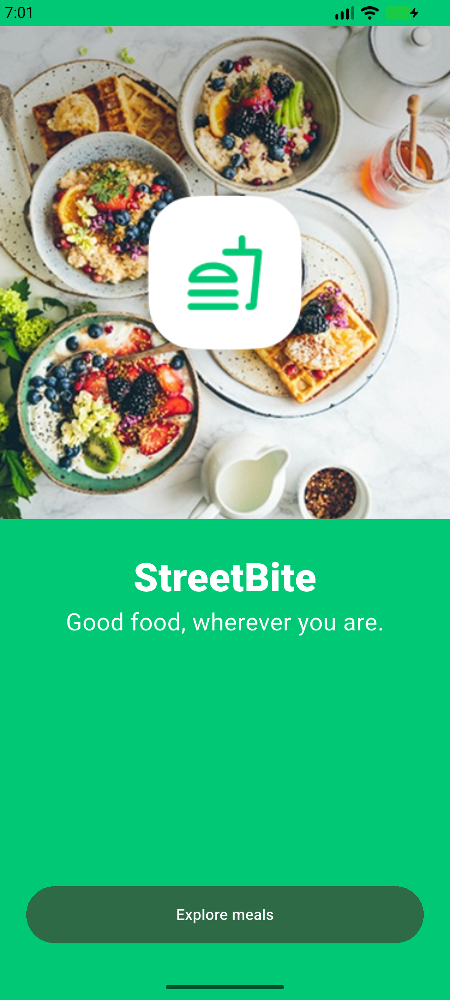
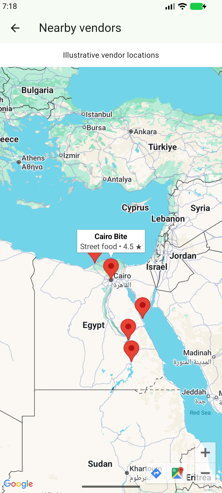

# StreetBite V1.0

Bilingual Flutter food discovery and demo ordering, by Mohammed Nasser. [Public repository](https://github.com/MohammedNasser0/streetbite).

## Features

- Live TheMealDB search, category filtering and offline query cache.
- Featured meals, five offers, meal details, favourites and reactive cart.
- Email/password authentication, Firestore profiles and order history.
- English/Arabic with RTL, persistent language and light/dark themes.
- Gallery profile thumbnail, biometric profile gate and device details.
- Five illustrative vendor locations on Google Maps.
- Cash and simulated card payment strategies; no real payments or restaurant dispatch.

## Architecture

`flutter_app/lib/` separates data sources/models/repositories, domain entities/contracts/use cases and presentation screens/widgets/BLoCs. GetIt provides dependencies. Builder creates user profiles; Factory chooses remote/cache sources; Singleton wraps Firestore; payment strategies share a common interface.

## Setup

Use Flutter 3.47.6 / Dart 3.13.5 and Java 17+. From `flutter_app/`:

```sh
cp lib/core/firebase_options.example.dart lib/core/firebase_options.dart
flutter pub get
flutter gen-l10n
flutter run
```

Replace the example with configuration for your own Firebase project; enable Email/Password and Firestore, then deploy `firestore.rules`. The local implementation uses the dedicated StreetBite project. Private configuration files are excluded from Git.

For Android Maps, create `flutter_app/android/maps.properties` containing `MAPS_API_KEY=YOUR_KEY`, enable Maps SDK for Android, and configure package/certificate restrictions. Build with:

```sh
flutter build apk --release --dart-define=MAPS_CONFIGURED=true
```

Android requests internet and biometric access; gallery selection uses the system picker. iOS includes gallery/Face ID explanations but still needs its own Firebase/Maps configuration and build verification. Current Android beta signing uses the development key; production signing is pending.

## Verification and delivery

Ten unit/widget tests passed on 12 October 2026, including English/Arabic delivery-form layouts at 375 and 412 logical pixels. Build 2 passed seven Appium scenarios: the five required cases, Maps, and cash checkout/order history after restart. Build 3 passed two targeted signup checks: numeric-name rejection and successful account/profile persistence. Ten live Firestore access checks passed. Version 1.0.0 (3) was uploaded to Firebase App Distribution and distributed to the two authorized testers. Tester acceptance and physical-device execution remain unverified.

[Beta tester release](https://appdistribution.firebase.google.com/testerapps/1:860880764428:android:416188fed65affb0f6f829/releases/7dopgsri4kak0). Distribution completed through Firebase CLI after login renewal. User-supplied dashboard screenshots confirm two invited testers, with zero accepted/downloaded at capture time. Originals containing personal emails are retained privately; see [distribution evidence](docs/distribution-evidence.md).

 

[Project presentation](presentation/StreetBite-project-final.pptx) covers the developer, planning, architecture, features and current verification status.

Jira project and code-review defect verification evidence are retained in the private delivery package. The real-device manual QA cycle remains open.

See [work status](WORK_STATUS.md), [QA plan](docs/test-plan.md), [traceability](docs/traceability.md) and [closure](docs/test-closure.md). This is an implementation in progress, not a completed submission.

## Design and data references

- [Food Delivery Mobile App UI Kit, Vlad Solomakha](https://www.figma.com/community/file/1352761962360670057/food-delivery-mobile-app-ui-kit), CC BY 4.0. Inspected Welcome, Home, Restaurant, Address and Checkout frames. Full screen coverage and fidelity remain under review.
- [TheMealDB API](https://www.themealdb.com/api.php), educational development key `1`. Recipes come from the API; prices, vendors and payment results are explicitly demonstration data.
