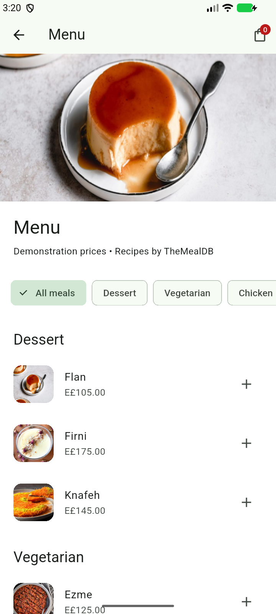
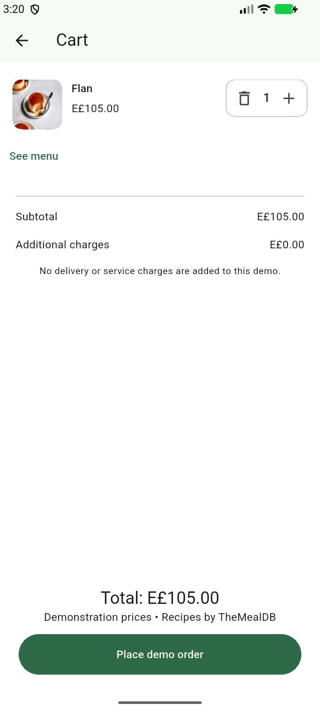
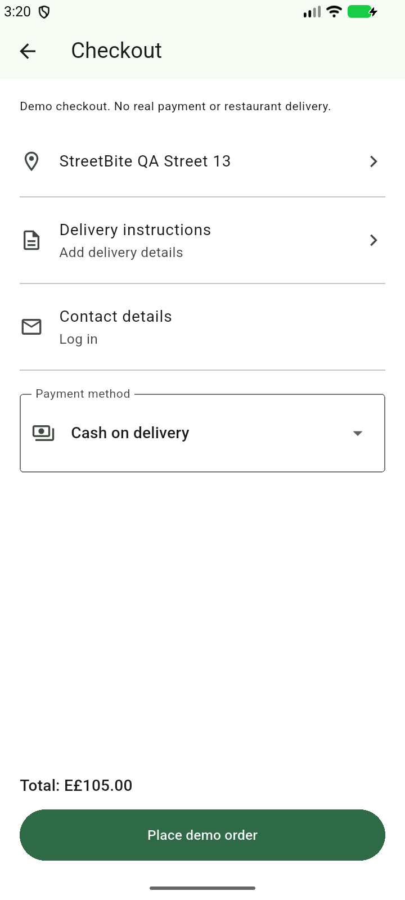

# StreetBite V1.0

Bilingual Flutter food discovery and demo ordering, by Mohammed Nasser. [Public repository](https://github.com/MohammedNasser0/streetbite).

## Features

- Live TheMealDB search, category filtering and offline query cache.
- Featured meals, five offers, meal details, favourites and reactive cart.
- Email/password authentication, Firestore profiles and order history.
- English/Arabic with RTL, persistent language and light/dark themes.
- Gallery profile thumbnail, biometric profile gate and device details.
- Five illustrative vendor locations on Google Maps.
- Cash and simulated card payment strategies; no real payments or restaurant dispatch.

## Architecture

`flutter_app/lib/` separates data sources/models/repositories, domain entities/contracts/use cases and presentation screens/widgets/BLoCs. GetIt provides dependencies. Builder creates user profiles; Factory chooses remote/cache sources; Singleton wraps Firestore; payment strategies share a common interface.

## Setup

Use Flutter 3.47.6 / Dart 3.13.5 and Java 17+. From `flutter_app/`:

```sh
cp lib/core/firebase_options.example.dart lib/core/firebase_options.dart
flutter pub get
flutter gen-l10n
flutter run
```

Replace the example with configuration for your own Firebase project; enable Email/Password and Firestore, then deploy `firestore.rules`. The local implementation uses the dedicated StreetBite project. Private configuration files are excluded from Git.

For Android Maps, create `flutter_app/android/maps.properties` containing `MAPS_API_KEY=YOUR_KEY`, enable Maps SDK for Android, and configure package/certificate restrictions. Build with:

```sh
flutter build apk --release --dart-define=MAPS_CONFIGURED=true
```

Android requests internet and biometric access; gallery selection uses the system picker. iOS includes gallery/Face ID explanations but still needs its own Firebase/Maps configuration and build verification. Current Android beta signing uses the development key; production signing is pending.

## Verification and delivery

Build **1.0.0 (13)** is the latest Android beta. Home and Checkout share a session delivery address, cleared across accounts. A grouped Menu, Browse category tiles, direct quantity controls and explicit cart subtotal/demo charges complement the existing profile support/navigation.

All **43 Flutter tests passed** and analyzer is clean. Four final native emulator cases passed: search recovery, categories/detail quantity, shared address/grouped menu/cart and screenshot tour. Five core physical cases and an owner-assisted fingerprint/profile retry passed on OPPO Android 16. Gallery/photo/restart evidence remains build 4; checkout/history/restart remains build 10. Historical verification retains its actual version scope.

**Distribution:** build **1.0.0 (13)** uploaded and distributed to both authorized testers on **14 October 2026**. [Current beta release](https://appdistribution.firebase.google.com/testerapps/1:860880764428:android:416188fed65affb0f6f829/releases/1p7qp7hs4ct48). Uploaded APK SHA256: `318b20bf2526d994377d4df2e9b4f43058029be8ddc361f24797b111454a95b3`. Tester acceptance is unverified. See [distribution evidence](docs/distribution-evidence.md).


The dashboard image documents build 1 invitations; it does not establish current-build distribution. Original screenshots remain private.

  
[Project presentation](presentation/StreetBite-project-review-build13.pptx) covers the developer, planning, architecture, features and current verification status. Phone screenshots, the genuine emulator biometric capture and original Firebase/Jira evidence are included only in the private delivery ZIP.

The [manual QA walkthrough](docs/manual-qa-walkthrough.md) explains how to execute and record the 43 planned cases, including Browse retry. Planned checks remain Not Run until actual manual execution.

See [primary acceptance](docs/core-acceptance.md), [physical verification](docs/physical-verification.md), [emulator verification](docs/emulator-verification.md), [QA plan](docs/test-plan.md), [traceability](docs/traceability.md) and [closure](docs/test-closure.md). Figma fidelity remains partial; map-tile diagnosis is deferred by the owner as bonus. Remaining manual cases stay Not Run. No final learning-platform submission has been made.

For a matching source/APK delivery archive, run `scripts/package-delivery.ps1` after committing the verified build and its presentation. Supply `-AndroidSdkPath` if the SDK is outside the standard Windows location. The script reads APK metadata with Android build-tools/aapt and rejects a source-version mismatch.

## Design and data references

- [Food Delivery Mobile App UI Kit, Vlad Solomakha](https://www.figma.com/community/file/1352761962360670057/food-delivery-mobile-app-ui-kit), CC BY 4.0. See the [frame inventory and fidelity gaps](docs/figma-frame-coverage.md). Full fidelity remains under review.
- [TheMealDB API](https://www.themealdb.com/api.php), educational development key `1`. Recipes come from the API; prices, vendors and payment results are explicitly demonstration data.

[دليل حزمة المراجعة والتسليم](docs/submission-guide.md) يوضح مكان APK والصور الخاصة وما يتطلب جهازًا حقيقيًا قبل الإغلاق النهائي.
