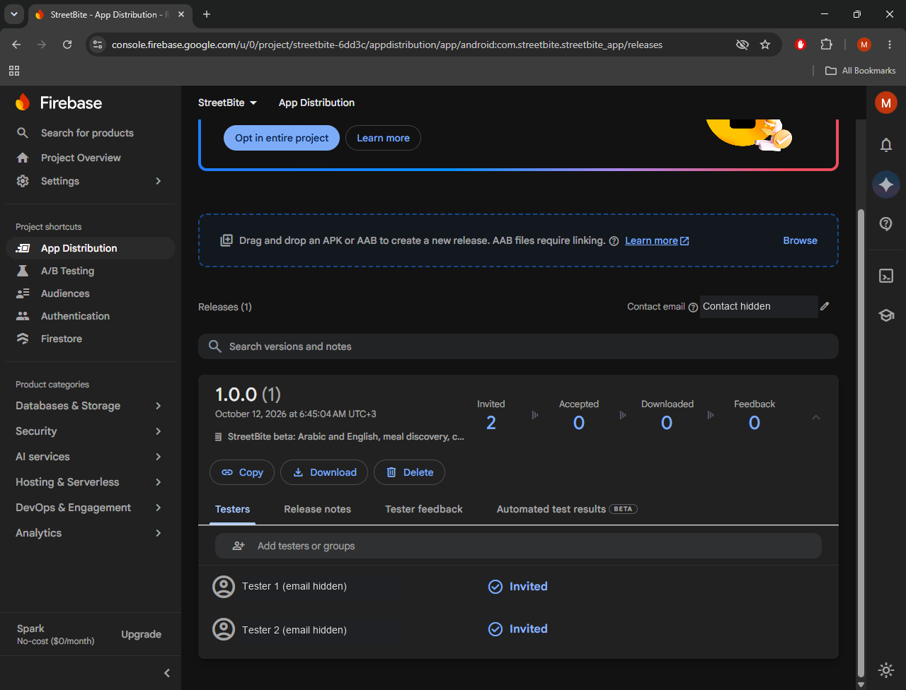
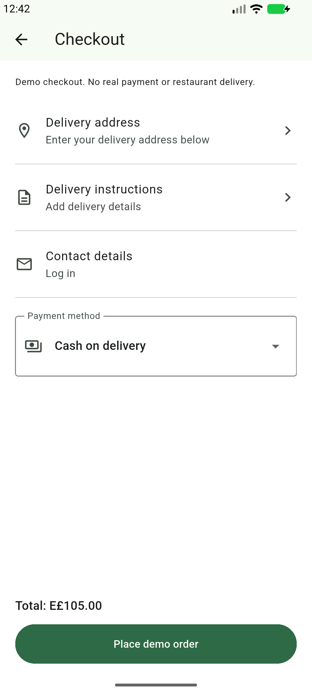
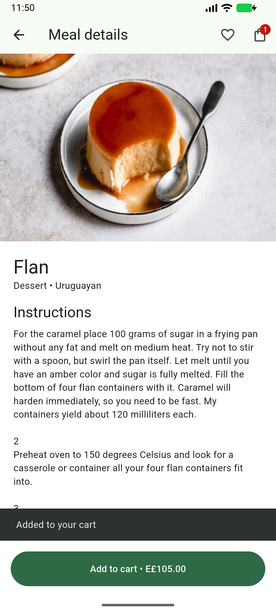
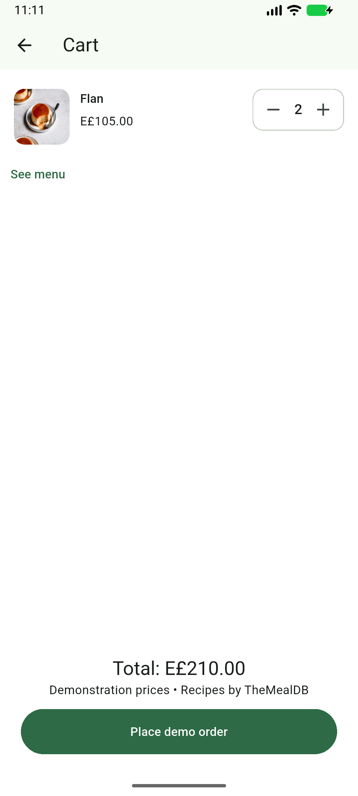

# StreetBite V1.0

Bilingual Flutter food discovery and demo ordering, by Mohammed Nasser. [Public repository](https://github.com/MohammedNasser0/streetbite).

## Unreleased source follow-up

Current source is version **1.0.0+11** and adds Browse retry for the last failed query, preserving the search input. All 31 Flutter tests passed. This follow-up has not been built or distributed; the tested APK, delivery ZIP and Firebase release described below remain build 10. Native verification and distribution of build 11 are pending.

## Features

- Live TheMealDB search, category filtering and offline query cache.
- Featured meals, five offers, meal details, favourites and reactive cart.
- Email/password authentication, Firestore profiles and order history.
- English/Arabic with RTL, persistent language and light/dark themes.
- Gallery profile thumbnail, biometric profile gate and device details.
- Five illustrative vendor locations on Google Maps.
- Cash and simulated card payment strategies; no real payments or restaurant dispatch.

## Architecture

`flutter_app/lib/` separates data sources/models/repositories, domain entities/contracts/use cases and presentation screens/widgets/BLoCs. GetIt provides dependencies. Builder creates user profiles; Factory chooses remote/cache sources; Singleton wraps Firestore; payment strategies share a common interface.

## Setup

Use Flutter 3.47.6 / Dart 3.13.5 and Java 17+. From `flutter_app/`:

```sh
cp lib/core/firebase_options.example.dart lib/core/firebase_options.dart
flutter pub get
flutter gen-l10n
flutter run
```

Replace the example with configuration for your own Firebase project; enable Email/Password and Firestore, then deploy `firestore.rules`. The local implementation uses the dedicated StreetBite project. Private configuration files are excluded from Git.

For Android Maps, create `flutter_app/android/maps.properties` containing `MAPS_API_KEY=YOUR_KEY`, enable Maps SDK for Android, and configure package/certificate restrictions. Build with:

```sh
flutter build apk --release --dart-define=MAPS_CONFIGURED=true
```

Android requests internet and biometric access; gallery selection uses the system picker. iOS includes gallery/Face ID explanations but still needs its own Firebase/Maps configuration and build verification. Current Android beta signing uses the development key; production signing is pending.

## Verification and delivery

Build **1.0.0 (10)** is the latest Android beta. Checkout now separates address/apartment, instructions and account contact rows, keeps total/order action fixed at the bottom, and preserves cash selection when a demo-card confirmation is cancelled. The localized title and notice make its demo scope clear. This moves the composition closer to the supplied Figma Checkout frame; full visual fidelity remains partial.

Final analyzer is clean. All **29 unit/widget tests passed** before a localized notice wording correction; both affected EN/AR compact Checkout tests passed again afterwards. The final APK passed native cash checkout, history/restart persistence and a separate screenshot tour on emulator. The eight core emulator scenarios and five required physical cases remain scoped to build 9. Full owner-assisted physical profile/photo/restart evidence remains build 4. Exact scopes are recorded in the verification documents.

**Distribution:** build **1.0.0 (10)** was uploaded and distributed to both authorized testers on **14 October 2026**. [Current beta release](https://appdistribution.firebase.google.com/testerapps/1:860880764428:android:416188fed65affb0f6f829/releases/10m6d1qnfpap0). Uploaded APK SHA256: `549280bd7c069657573bc40c3609c31d647246432198a5cb04f2fb1a0949bb5b`. Tester acceptance/installation is unverified. See [distribution evidence](docs/distribution-evidence.md).



The dashboard image documents build 1 invitations; it does not establish current-build distribution. Original screenshots remain private.

  

[Project presentation](presentation/StreetBite-project-review-build10.pptx) covers the developer, planning, architecture, features and current verification status. Phone screenshots, the genuine emulator biometric capture and original Firebase/Jira evidence are included only in the private delivery ZIP.

The [manual QA walkthrough](docs/manual-qa-walkthrough.md) explains how to execute and record the 36 planned cases. Eight added cases cover onboarding, browse, Checkout, address and settings; they remain Not Run.

See [primary acceptance](docs/core-acceptance.md), [physical verification](docs/physical-verification.md), [emulator verification](docs/emulator-verification.md), [QA plan](docs/test-plan.md), [traceability](docs/traceability.md) and [closure](docs/test-closure.md). Figma fidelity remains partial; map-tile diagnosis is deferred by the owner as bonus. Remaining manual cases stay Not Run. No final learning-platform submission has been made.

## Design and data references

- [Food Delivery Mobile App UI Kit, Vlad Solomakha](https://www.figma.com/community/file/1352761962360670057/food-delivery-mobile-app-ui-kit), CC BY 4.0. See the [frame inventory and fidelity gaps](docs/figma-frame-coverage.md). Full fidelity remains under review.
- [TheMealDB API](https://www.themealdb.com/api.php), educational development key `1`. Recipes come from the API; prices, vendors and payment results are explicitly demonstration data.
